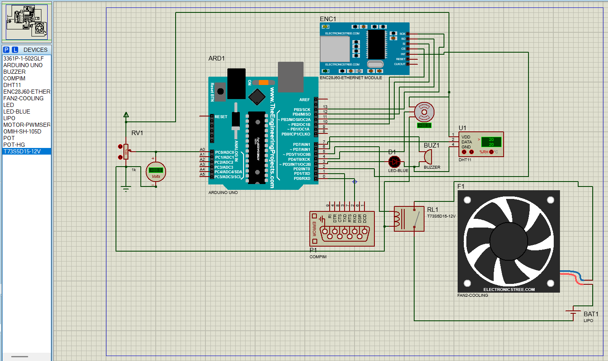

# EggIncubator-LabVIEW

*Projet réalisé avec [DarkCom-lab](https://github.com/DarkCom-lab).*

Incubateur d'œufs automatisé qui surveille la température et l'humidité, déclenche le refroidissement quand c'est nécessaire et envoie ses mesures en temps réel vers un tableau de bord LabVIEW par liaison série. Le système repose sur une carte Arduino Uno, un capteur DHT11, une fenêtre de ventilation motorisée par un servomoteur, un ventilateur, un buzzer et un potentiomètre pour régler la consigne à la main. Une évolution IoT avec le module Ethernet ENC28J60 est également proposée.



*Schéma de simulation sous Proteus : Arduino Uno, capteur DHT11, potentiomètre, LED, buzzer, servomoteur, relais et ventilateur, port COMPIM pour la liaison avec LabVIEW, et module Ethernet ENC28J60 prévu pour l'évolution IoT.*

---

## Sommaire

- [Fonctionnalités](#fonctionnalités)
- [Composants et brochage](#composants-et-brochage)
- [Principe de fonctionnement](#principe-de-fonctionnement)
- [Logique de régulation](#logique-de-régulation)
- [Communication avec LabVIEW](#communication-avec-labview)
- [Structure du dépôt](#structure-du-dépôt)
- [Installation](#installation)
- [Évolutions possibles](#évolutions-possibles)
- [Auteurs](#auteurs)

---

## Fonctionnalités

- Mesure de la température et de l'humidité avec un capteur DHT11.
- Refroidissement automatique dès que la température ou l'humidité dépasse son seuil maximal.
- Fenêtre de ventilation pilotée par servomoteur, qui s'ouvre et se ferme avec le ventilateur.
- Réglage de la température maximale (de 25 à 40 °C) à l'aide d'un potentiomètre.
- Supervision et commande à distance depuis LabVIEW, ou depuis n'importe quel terminal série.
- Commande manuelle du ventilateur, avec retour automatique au mode auto après 10 secondes d'inactivité.
- Alerte sonore (buzzer) lorsque l'humidité dépasse la limite haute.
- Alerte lumineuse (LED) lorsque la température atteint ou dépasse le maximum.
- Simulation sous Proteus, avec le composant COMPIM pour la liaison avec LabVIEW.
- Code modulaire, prêt à être étendu avec Ethernet / IoT.

---

## Composants et brochage

| Composant | Broche Arduino | Remarque |
|---|---|---|
| Capteur DHT11 | D7 | Température et humidité |
| Potentiomètre | A0 | Fixe la température maximale (25 à 40 °C) |
| LED de surchauffe | D3 | S'allume quand la température ≥ maximum |
| Servomoteur | D4 | Actionneur de la fenêtre (0° fermée, 90° ouverte) |
| Ventilateur (relais / MOSFET) | D5 | Commande du refroidissement |
| Buzzer | D6 | Sonne quand l'humidité est trop élevée |
| Alimentation | 5 V et GND | Batterie LiPo ou USB |

> **Remarque :** le code pilote le ventilateur directement depuis la broche D5. Pour un ventilateur 12 V ou une résistance chauffante, ajoute un module relais ou un montage à transistor.

---

## Principe de fonctionnement

1. Le système lit la température et l'humidité toutes les 100 ms.
2. Si la température atteint ou dépasse `maxTemperature`, la LED s'allume.
3. Si l'humidité atteint ou dépasse `maxHumidity`, le buzzer émet des bips.
4. Dès que l'une des deux conditions est vraie, le ventilateur et la fenêtre s'activent pour refroidir et aérer.
5. Une hystérésis (3 °C pour la température, 5 % pour l'humidité) évite les basculements trop fréquents.
6. Toutes les 2 secondes, l'Arduino envoie un paquet de données à LabVIEW.
7. LabVIEW peut renvoyer des commandes pour modifier les seuils ou piloter le ventilateur à la main.

---

## Logique de régulation

- La consigne de température vient soit du potentiomètre, soit d'une commande `T` envoyée par LabVIEW.
- Une commande `T` n'est utilisée que pour **un seul** cycle de données, puis le système revient au potentiomètre (sauf si `AUTO` est envoyé sans argument).
- Le ventilateur et la fenêtre fonctionnent en binôme :
  - **Début du refroidissement** : la fenêtre s'ouvre, puis après un court délai le ventilateur démarre.
  - **Fin du refroidissement** : le ventilateur s'arrête, puis après un court délai la fenêtre se ferme.
- La commande manuelle `F` désactive le refroidissement automatique jusqu'à une commande `AUTO` ou jusqu'à 10 secondes d'inactivité.

---

## Communication avec LabVIEW

LabVIEW (ou un moniteur série) se connecte à l'Arduino par USB en matériel réel, ou via COMPIM dans la simulation Proteus.

**Paramètres série :** 9600 bauds, 8N1.

### Données envoyées vers LabVIEW (toutes les 2 s)

| Champ | Exemple | Signification |
|---|---|---|
| Numéro de cas | case20 | Augmente de 10 à chaque envoi |
| Température | 31 | Température actuelle (°C, entier) |
| Humidité | 82 | Humidité actuelle (%) |
| État température | 1 | 1 = température ≥ maximum, 0 = normal |
| État ventilateur | 1 | 1 = en marche, 0 = arrêté |

### Commandes reçues depuis LabVIEW

| Commande | Rôle | Exemple |
|---|---|---|
| `T <valeur>` | Définit la température maximale | `T 38` |
| `H <valeur>` | Définit l'humidité maximale | `H 65` |
| `F` | Active ou désactive le ventilateur manuellement (prioritaire sur l'auto) | `F` |
| `AUTO` | Retour au mode automatique (potentiomètre) | `AUTO` |
| `AUTOT <valeur>` | Retour en auto et fixe la température pour un cycle | `AUTOT 35` |

Les commandes ne sont pas sensibles à la casse et peuvent être combinées avec `AUTO`.

---

## Structure du dépôt

```
.
├── README.md
├── future_enhancement.png         # Schéma de simulation Proteus
├── New Project [Autosaved].pdsprj # Simulation Proteus
├── Untitled 1.vi                  # Tableau de bord LabVIEW
├── final_project1/                # Croquis Arduino
│   ├── final_project1.ino         # Code source principal
│   └── build/                     # Fichier compilé (.hex)
└── libraries/                     # Bibliothèques pour Proteus
    ├── ENC28J60 Ethernet Module Library/
    └── Fan Models Library/
```

---

## Installation

### Matériel

1. Câbler les composants selon le tableau de brochage.
2. Alimenter l'Arduino (USB ou batterie LiPo).
3. Brancher le câble USB au PC pour utiliser LabVIEW ou un moniteur série.

### Arduino IDE

1. Installer la bibliothèque **DHT sensor library** d'Adafruit (via le gestionnaire de bibliothèques).
2. Vérifier que la bibliothèque **Servo** est disponible (incluse par défaut).
3. Ouvrir `final_project1/final_project1.ino`.
4. Choisir la carte **Arduino Uno** et téléverser le code.

### LabVIEW (optionnel)

1. Ouvrir le fichier `Untitled 1.vi`, ou créer son propre panneau.
2. Configurer le port série VISA (COMx, 9600 bauds).
3. Lire la chaîne reçue et analyser le format `caseX: …`.
4. Envoyer les commandes avec VISA Write lors de l'appui sur les boutons.

### Simulation Proteus

1. Ouvrir le fichier `.pdsprj`.
2. Le composant COMPIM assure la liaison série virtuelle avec LabVIEW.
3. Lancer la simulation et tester l'interaction.

---

## Évolutions possibles

Le schéma de simulation prévoit déjà le module Ethernet **ENC28J60**. Une évolution IoT basée sur ce module permettrait :

- la surveillance à distance via un serveur web ou MQTT ;
- l'enregistrement des données sur une plateforme cloud (ThingSpeak, Blynk, etc.) ;
- l'envoi d'alertes par SMS ou e-mail en cas de dépassement de seuil ;
- l'intégration dans un système de ferme connectée.

La bibliothèque du module ENC28J60 pour Proteus est déjà fournie dans le dossier `libraries/`.

---

## Auteurs

Projet réalisé par [Oumayma Bouaouaja](https://github.com/oumaymabouaoija) et [DarkCom-lab](https://github.com/DarkCom-lab).
